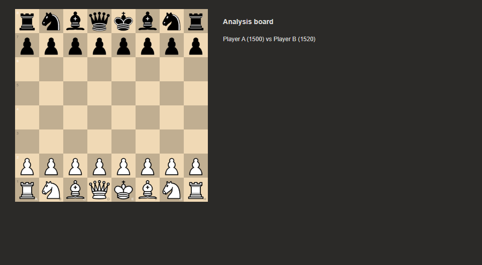
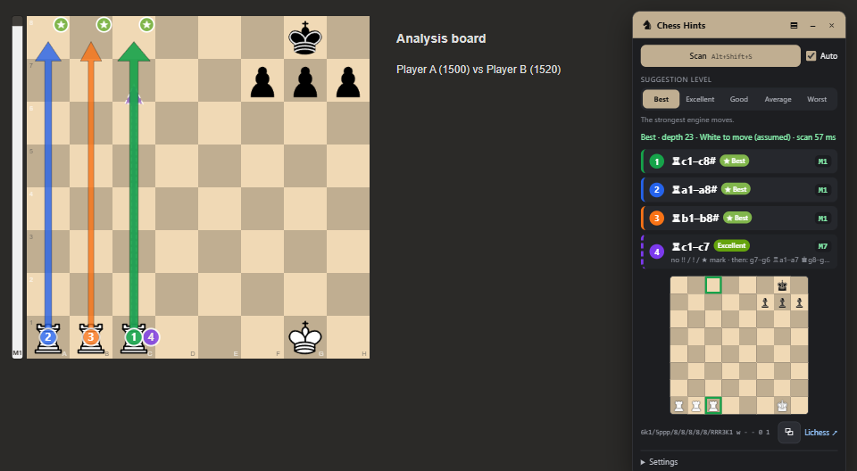

# Chess Hints

[](https://github.com/stxxchu/Chess-best-move-extension/releases/latest/download/chess-hints.zip) [](https://github.com/stxxchu/Chess-best-move-extension/releases/latest)

[English](README.md)

Rozszerzenie do Brave, Chrome i Edge. Znajduje szachownicę na ekranie, rozpoznaje pozycję i podpowiada ruchy na wybranym poziomie, od najlepszych po najgorsze. Stockfish 19 działa lokalnie w przeglądarce, nic nie jest nigdzie wysyłane.



## Co potrafi

- **Dowolna strona i motyw.** Plansza jest znajdowana na zrzucie karty, w obu orientacjach, także gdy jest rysowana w `<canvas>`.
- **Uczy się figur raz na stronę.** Wystarczy pokazać pozycję startową. Po zmianie zestawu figur samo to zauważy i poprosi o ponowną kalibrację.
- **Poziomy podpowiedzi:** Najlepsze, Doskonałe, Dobre, Przeciętne i Najgorsze.
- **Oznaczenia ruchów jak na chess.com:** `!!` Genialny, `!` Świetny, `★` Najlepszy, rysowane w rogu pola docelowego. Gdy wszystkie trzy podpowiedzi mają takie oznaczenie, czwarta przerywana strzałka pokazuje najlepszy ruch bez oznaczenia.
- **Pasek oceny** obok planszy.
- **Tryb matu** (`M`): pokazuje forsownego mata z całą drogą do niego, a gdy mata jeszcze nie ma, ruchy atakujące króla.
- **Tryb Auto** śledzi partię: wie, czyj jest ruch, pilnuje roszad i bicia w przelocie, czeka, gdy myśli przeciwnik.
- **Poprawianie źle rozpoznanego pola** kliknięciem na małej planszy. Poprawka jest zapamiętywana, więc kolejne skany już się nie mylą.
- **Szybkość:** pierwsze strzałki pojawiają się ok. 0,1 s po ruchu przeciwnika i dopracowują się, gdy silnik liczy głębiej.
- Interfejs po polsku i angielsku, motyw ciemny i jasny, tryb kompaktowy, klawisze `1`–`5` zmieniają poziom.



## Instalacja

1. Kliknij **Pobierz** na górze tej strony (albo weź **`chess-hints.zip`** z [najnowszego wydania](../../releases/latest)). Nie „Source code”: to całe repozytorium, a wtyczka jest w jego podfolderze `extension`.
2. Rozpakuj. W rozpakowanym folderze `manifest.json` jest od razu w środku.
3. Otwórz `brave://extensions` (albo `chrome://extensions`) i włącz **Tryb dewelopera**.
4. Kliknij **Załaduj rozpakowane** i wskaż ten folder.

Komunikat „Brak pliku manifestu lub nie można go odczytać” oznacza zły folder: wskaż ten, w którym leży `manifest.json` (w kodzie źródłowym to `extension`).

## Użycie

1. Otwórz planszę w pozycji startowej, kliknij ikonę Chess Hints (albo `Alt+Shift+C`), potem **Skanuj**. Pierwszy skan na nowej stronie to kalibracja.
2. Wybierz poziom i włącz **Auto**, żeby podpowiedzi odświeżały się po każdym ruchu.

| Klawisz | Działanie |
|---|---|
| `Alt+Shift+C` | pokaż / ukryj panel |
| `Alt+Shift+S` | skanuj teraz |
| `1`–`5` | zmień poziom (gdy panel jest otwarty) |
| `M` | włącz / wyłącz tryb matu |

Skróty można zmienić w `brave://extensions/shortcuts`. Język panelu wybierzesz w ustawieniach (domyślnie taki jak przeglądarki).

## Poziomy

Silnik ocenia 12 najlepszych kandydatów. Każdy ruch dostaje kategorię według tego, ile szans na wygraną traci względem najlepszego, w tej samej skali co analiza partii na chess.com.

| Poziom | Ruchy |
|---|---|
| Najlepsze | najmocniejsze ruchy silnika |
| Doskonałe | strata do 2% |
| Dobre | strata 2–5% |
| Przeciętne | strata 5–10% |
| Najgorsze | najsłabsze ruchy w pozycji (silnik sprawdza wtedy wszystkie legalne ruchy) |

Zmiana poziomu działa od razu, poza przejściem na „Najgorsze” i z powrotem. Jeśli na danym poziomie nie ma trzech ruchów, lista jest uzupełniana lepszymi, nigdy gorszymi, i panel o tym informuje. Pomyłki i błędy pojawiają się wyłącznie na poziomie „Najgorsze”, więc w pozycji z jednym ratującym ruchem pozostałe poziomy pokazują tylko ten ruch.

Oznaczenia `!!` i `!` są przybliżeniem, bo chess.com nie publikuje swoich zasad. Tutaj „Genialny” to poświęcenie figury, które jest najlepszym lub prawie najlepszym ruchem, a „Świetny” to jedyny dobry ruch w pozycji.

## Tryb matu

Włączasz go przełącznikiem **♚ Mat** albo klawiszem `M`; kliknięcie poziomu go wyłącza.

- **Jest forsowny mat:** napis „Mat w N” nad planszą, strzałka Twojego następnego ruchu i cała droga do mata w panelu (Twój ruch, odpowiedź, Twój ruch… aż do mata). W trybie Auto prowadzi przez partię i odlicza.
- **Mata jeszcze nie ma:** do trzech grywalnych ruchów, które najmocniej atakują króla (szachy, odbieranie mu pól, podciąganie figur). Ruchy oddające materiał albo partię nie są pokazywane.
- **Przeciwnik ma forsownego mata:** ostrzeżenie i najlepsza obrona.

## Szybkość

Czas od ruchu przeciwnika do pierwszych strzałek (`npm run bench`):

| Ustawienie strony | Czas |
|---|---|
| animacja figur wyłączona | ok. 90 ms |
| animacja figur włączona | ok. 300 ms, z czego ok. 200 ms to sama animacja |

Najszybciej działa przy wyłączonej animacji ruchu figur w ustawieniach strony. Chrome pozwala na dwa zrzuty karty na sekundę, więc przy bardzo szybkiej wymianie ruchów skan może chwilę poczekać.

## Coś nie działa?

W ustawieniach panelu kliknij **Zgłoś problem**. Otworzy się zgłoszenie na GitHubie z wypełnioną wersją, przeglądarką, stroną, pozycją i diagnostyką, a obraz planszy trafi do schowka, żeby wkleić go do zgłoszenia.

## Rozwój

```
cd tests
npm install
npm test
```

Opis skryptów testowych i wydawania wersji jest w [README po angielsku](README.md#development).

## Uczciwa gra

Używanie silnika w partiach z innymi ludźmi łamie regulaminy chess.com i lichess i kończy się banem. Chess Hints jest do analizy, zadań, gry z botami i nauki.

## Licencja

GPL-3.0. W `extension/engine/` jest Stockfish (GPL-3.0) w wersji z projektu stockfish.js (Nathan Rugg, Chess.com). Figury na zrzutach to zestaw cburnett (GPLv2+).
